# NimbusPL – Zegar z kalendarzem, pogodą, PM2.5 i Meteoalarmem (AWTRIX NG / AWTRIX Light)

[](https://bluebeards.org/awtrix/)
[]()
[]()

<p align="center">

| Karuzela paneli | Meteoalarm (IMGW) | Faza księżyca |
| :---: | :---: | :---: |
| 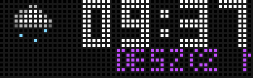 | 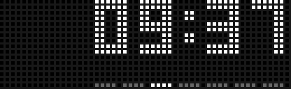 | 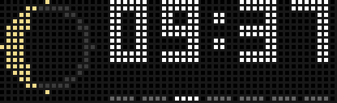 |

</p>

**NimbusPL** to rozbudowany, w pełni spolszczony fork popularnej aplikacji **Nimbus** przeznaczony dla zegarów z małą matrycą LED (52x16) sterowanych oprogramowaniem **AWTRIX Light** lub **Awtrix NG** (np. Ulanzi TC001 / TC002).

Aplikacja płynnie łączy wyświetlanie zegara, kalendarza, prognozy pogody z Open-Meteo, stężenia pyłów **PM2.5**, odczytów temperatury i wilgotności w pomieszczeniu, ostrzeżeń **Meteoalarm** (IMGW) oraz serii efektów wizualnych (m.in. efekt wycieraczki chroniący matrycę przed powidokami).

---

## 🆕 Nowości w v2.7.0 PL

### 🌙 Faza księżyca na karuzeli

- Nowy panel karuzeli **`moon`** — **ikonka księżyca na czarnym tle** z aktualną fazą, wyliczaną z daty (pełny cykl synodyczny 29,53 dnia).
- Terminator rysowany **w sposób ciągły** (nie tylko 8 faz) — sierp, kwadry, garby i pełnia wyglądają jak na prawdziwym niebie; ciemna część tarczy jest obrysowana na szaro, więc widać też **nów**.
- Na dużej tarczy panel pokazuje małą ikonkę fazy + nazwę fazy (`NÓW`, `SIERP`, `I KWADRA`, `GARB`, `PEŁNIA`, `III KWADRA`).
- **Opcja włącz/wyłącz `Faza księżyca`** (grupa *Karuzela*, domyślnie włączona) — panel sam dołącza się do rotacji, tak jak meteoalarm.

<p align="center">
  
</p>

---

## 🆕 Nowości w v2.6.0 PL

### 🌦️ Wszystkie stany pogody Open-Meteo (16 stanów + ikonki)

- Pełne pokrycie kodów WMO z Open-Meteo: **16 stanów pogody** z osobnymi ikonkami i animowanymi opadami — doszły m.in. **deszcz marznący, mżawka marznąca, krupa śnieżna, przelotny deszcz, przelotny śnieg** i **burza z gradem**.
- Każdy stan ma własny kolor i tempo kropel/platków opadu (m.in. lodowoniebieskie kropki dla opadów marznących), a burza z gradem dodatkowo błyskawicę.
- **Opis pogody przeniesiony do lewej strony** — krótki wyświetla się statycznie przy lewej krawędzi, długi (np. `DESZCZ MARZNĄCY`) przewija się w lewo, a **odstęp między powtórzeniami przewijanego opisu jest większy** (28 px przerwy).
- **Polskie znaki w opisach** (`ŚNIEG`, `ŚNIEŻYCA`, `MGŁA`, `MŻAWKA`, `DESZCZ MARZNĄCY`…), a nocą zamiast „Słonecznie” pokazuje się **`CZYSTE NIEBO`**.
- **Poprawione renderowanie ikonek** — piksele rysowane 1:1 (wcześniej część kolorów znikała albo rozciągała ikonę).

---

## 🆕 Nowości w v2.5.1 PL

### 🌤️ Panel pogody — wygodniejszy odczyt

- **Pasek dni tygodnia znika na czas panelu pogody** — ikonka i przewijany opis mają całą szerokość i nic ich nie zasłania; pasek wraca, gdy karuzela przechodzi do kolejnego panelu.
- **Nowy suwak `Czas panelu pogody`** (grupa *Karuzela*, domyślnie 10 s) — osobny czas wyświetlania ikonki pogody z przewijanym opisem, niezależny od `Czasu pozostałych paneli`. Wydłuż go, żeby spokojnie przeczytać cały opis.
- **Fioletowy opis pogody**: pojedynczy opis (np. `DESZCZ`) wyświetla się **statycznie, gdy mieści się** w szerokości ekranu, a gdy jest dłuższy (np. własne opisy) — **przewija się w lewo** (od v2.6.0 przy lewej krawędzi).

---

## 🆕 Nowości w v2.5.0 PL

### 🌤️ Nowy panel pogody (tarcze kartka / pierścień)

- Ikonka pogody została **zmniejszona do wysokości godziny** — zamiast dużego symbolu na całą wysokość pola panelu, nad kompozycją jest teraz mała ikonka stanu nieba.
- Pod ikonką, **na całą szerokość zegara (52 px)**, pokazuje się **opis pogody** (np. `DESZCZ`, `SNIEG`, `ZACHMURZENIE`) — krótki wyświetla się statycznie, dłuższy przewija się w lewo (od v2.5.1 w kolorze fioletowym).
- Kropki opadów (deszcz / śnieg) animują się nad ikonką; od v2.5.1 pasek dni tygodnia jest na czas panelu ukryty, a długość wyświetlania ustawisz suwakiem `Czas panelu pogody`.

### 🗑️ Usunięta tarcza `klapka`

- Stylizowany zegar klapkowy (*split-flap*) został **całkowicie usunięty** — był niefunkcjonalny na AWTRIX NG i mylił w menu. Do wyboru pozostały trzy w pełni działające tarcze: `kartka`, `pierścień`, `duży`.
- Zapisane ustawienia z `klapka` są automatycznie mapowane na `kartka` (bez błędów po aktualizacji).

---

## 🆕 Nowości w v2.4.0 PL

### 🚨 Meteoalarm (IMGW) — ostrzeżenia meteorologiczne

- **Automatyczny powiat**: aplikacja sama wyznacza najbliższy **powiat (kod TERYT)** na podstawie współrzędnych `Lat`/`Lon` — nie trzeba nic podawać. Można też wpisać kod TERYT ręcznie.
- Dane pobierane z oficjalnego API **IMGW** (`danepubliczne.imgw.pl`, polskie źródło Meteoalarm).
- Komunikat zawiera **rodzaj zagrożenia i czas jego obowiązywania**, np. `Silny wiatr 01:00-10:00` (przy zagrożeniu przechodzącym przez północ również z datami).
- Kolor komunikatu odpowiada stopniowi ostrzeżenia: 🟡 1, 🟠 2, 🔴 3.
- **Częstotliwość konfigurowalna osobno**: co ile minut pokazywać komunikat *w trakcie* zagrożenia i co ile *przed* jego rozpoczęciem (domyślnie 10 min / 60 min).
- **Czas wyświetlania komunikatu** ustawiany suwakiem (5–120 s).
- Alert **przejmuje pole karuzeli tylko na czas komunikatu** — po jego zakończeniu karuzela wraca sama.

Na tarczy **kartka** / **pierścień** alert wygląda tak (kafelek `METEOALARM` u góry, komunikat na całą szerokość pod zegarem, pasek dni schowany na czas komunikatu):

<p align="center">
  
</p>

Na tarczy **duży** alert pojawia się jako panel `ALARM` z przewijanym tekstem:

<p align="center">
  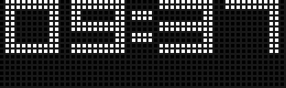
</p>

### ⌚ Pozostałe zmiany

- **Nazwa aplikacji**: `Nimbus` → **`NimbusPL`** (łatwiej odróżnić od oryginalnego Nimbusa w panelu AWTRIX NG).
- **Duża tarcza**: 5-literowy dzień tygodnia (`NIEDZ` / `PONIE` / `WTORE` / `SRODA` / `CZWAR` / `PIATE` / `SOBOT`).
- **Tarcza kartka**: godzina przy górnej krawędzi — dzięki temu pod zegarem jest miejsce na pełnowymiarowy komunikat meteoalarmu.

---

## 🎨 Tarcze Zegara (Style Wyglądu)

Aplikacja oferuje 3 unikalne warianty tarczy zegara do wyboru w panelu konfiguracyjnym:

| Podgląd | Nazwa w opcjach | Opis |
| :---: | :---: | :--- |
| 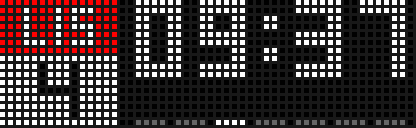 | `kartka` | **Klasyczna kartka z kalendarza** z animowanym "zrywaniem" kartki, godziną przy górnej krawędzi i miejscem pod nią na komunikaty. |
| 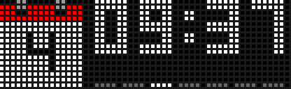 | `pierścień` | **Nowoczesna tarcza cyfrowa** otoczona płynnie obracającym się pierścieniem sekundnika. |
| 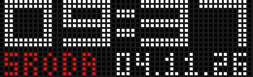 | `duży` | **Duży zegar na pełną szerokość** matrycy z 5-literowym dniem tygodnia, przewijanym u dołu tekstem daty, opisem pogody i alertami meteoalarmu. |

---

## 🚨 Meteoalarm — jak to działa?

1. W opcjach włącz **`Włącz Meteoalarm`** (grupa *Pogoda i Powietrze*).
2. Aplikacja bierze współrzędne `Lat`/`Lon` (te same, których używa Open-Meteo) i dopasowuje do nich **najbliższy powiat** z wbudowanej tabeli 380 powiatów (kod TERYT + środek). Jeśli chcesz wymusić konkretny powiat, wpisz jego 4-cyfrowy kod w polu **`TERYT powiatu`** (np. `1465` dla Warszawy). Kody powiatów znajdziesz w wyszukiwarce GUS: [eteryt.stat.gov.pl](https://eteryt.stat.gov.pl/).
3. Co `Odświeżanie Meteoalarmu` (domyślnie 10 min) aplikacja odpytuje API IMGW o ostrzeżenia dla tego powiatu.
4. Gdy jest aktywne ostrzeżenie, co `Częstotliwość w trakcie zagrożenia` (domyślnie 10 min) wyświetla komunikat; gdy ostrzeżenie jeszcze nie obowiązuje — co `Częstotliwość przed zagrożeniem` (domyślnie 60 min).
5. Komunikat (długość ustawia `Czas komunikatu`) **przejmuje pole karuzeli**: na tarczy kartka/pierścień pojawia się kafelek `METEOALARM` + tekst na całej szerokości pod zegarem (pasek dni tygodnia jest wtedy schowany), a na tarczy duży — panel `ALARM` w miejscu linii daty.
6. Po zakończeniu komunikatu karuzela wraca do normalnego działania.

> ℹ️ **Dlaczego podpowiedzi w panelu są krótkie?** AWTRIX NG ucina teksty pomocy (`help`) do 96 znaków i nie renderuje w nich linków — to limit firmware, którego aplikacja nie może obejść. Pełne opisy, linki i instrukcje znajdziesz w tym README (oraz na stronie aplikacji w AWTRIX Hub).

> ℹ️ **Województwo czy powiat?** API IMGW zwraca ostrzeżenia per powiat, dlatego alert dotyczy **powiatu**, a nie całego województwa. Dzięki temu komunikaty są precyzyjniejsze (np. "Silny wiatr" tylko tam, gdzie faktycznie obowiązuje).

---

## 🌟 Główne Funkcje

### 1. 🍃 Jakość Powietrza PM2.5 (Open-Meteo Air Quality)
- **Bez zewnętrznych czujników** – dane o stężeniu pyłów PM2.5 pobierane są automatycznie z darmowego API Open-Meteo na podstawie podanych współrzędnych geograficznych (`Lat`, `Lon`).
- **Dedykowany układ graficzny:** po lewej stronie wyświetlany jest biały napis **PM**, a po prawej boks z kolorowym tłem i pogrubioną, czarną wartością stężenia.
- **Dynamiczne kolory wg norm jakości powietrza WHO/UE:**

| Stężenie PM2.5 | Kolor tła | Jakość powietrza |
| :--- | :---: | :--- |
| $\le 12\,\mu\text{g/m}^3$ | 🟢 **Zielony** | **Dobra** – czyste powietrze |
| $13 - 35\,\mu\text{g/m}^3$ | 🟡 **Żółty** | **Umiarkowana** – dopuszczalna jakość |
| $36 - 55\,\mu\text{g/m}^3$ | 🟠 **Pomarańczowy** | **Niezdrowa** dla grup wrażliwych |
| $> 55\,\mu\text{g/m}^3$ | 🔴 **Czerwony** | **Zła / Bardzo zła** – wysokie zanieczyszczenie |

### 2. 🌤️ Rozbudowana Pogoda (16 Stanów WMO)
- Pełna integracja z **Open-Meteo Forecast API** — obsłużone są **wszystkie kody WMO**.
- Na tarczach `kartka` / `pierścień` panel pogody to **mała ikonka na wysokości godziny** z animowanymi kropkami opadów, a pod nią **fioletowy opis stanu** (np. `DESZCZ`) — statyczny przy lewej krawędzi, gdy się mieści, przewijany w lewo, gdy jest dłuższy.
- **16 stanów pogodowych** z ikonkami pikselowymi i animacjami opadów:

| Stan | Kody WMO |
| :--- | :---: |
| ☀️ Słonecznie (dzień) / 🌙 Czyste niebo (noc) | `0` |
| 🌤️ Zachmurzenie | `1`, `2` |
| ☁️ Chmury | `3` |
| 🌫️ Mgła | `45`, `48` |
| 🌦️ Mżawka | `51`, `53`, `55` |
| ❄️ Mżawka marznąca | `56`, `57` |
| 🌧️ Deszcz | `61`, `63` |
| ⛈️ Ulewa | `65` |
| 🧊 Deszcz marznący | `66`, `67` |
| 🌨️ Śnieg | `71`, `73` |
| ❄️ Śnieżyca | `75` |
| 🌨️ Krupa śnieżna | `77` |
| 🌦️ Przelotny deszcz | `80`, `81`, `82` |
| 🌨️ Przelotny śnieg | `85`, `86` |
| ⛈️ Burza | `95` |
| 🌩️ Burza z gradem | `96`, `99` |

### 🎬 Animacje wszystkich stanów (GIF)

| | | |
| :---: | :---: | :---: |
| 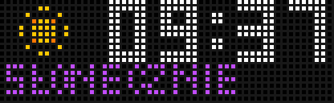<br>Słonecznie | 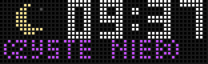<br>Słonecznie (noc) | 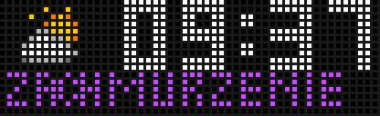<br>Zachmurzenie |
| 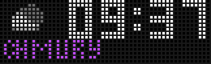<br>Chmury | 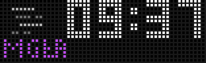<br>Mgła | 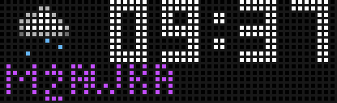<br>Mżawka |
| 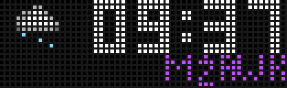<br>Mżawka marznąca | 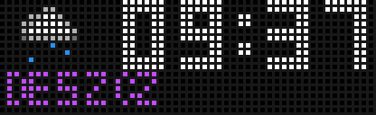<br>Deszcz | 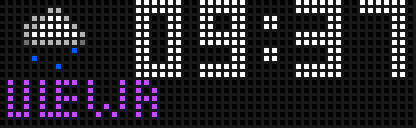<br>Ulewa |
| 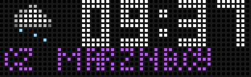<br>Deszcz marznący | 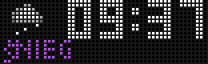<br>Śnieg | 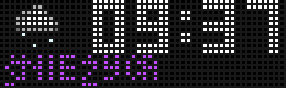<br>Śnieżyca |
| 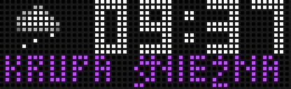<br>Krupa śnieżna | 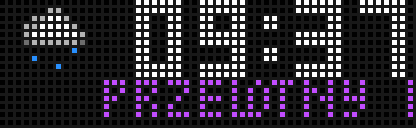<br>Przelotny deszcz | 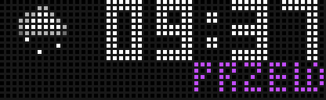<br>Przelotny śnieg |
| 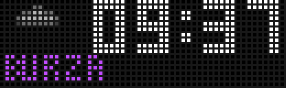<br>Burza | 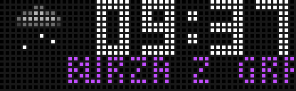<br>Burza z gradem | |

### 3. 🧹 Efekt "Wycieraczki" (Ochrona Matrycy LED)
- Co dokładnie 5 minut przez ekran przesuwa się płynny, czarny pas czyszczący (800 ms).
- Efekt odświeża diody LED, zapobiega utrwalaniu powidoków (*burn-in*) i dodaje unikalny retro akcent.

### 4. 🇵🇱 Pełne Spolszczenie i Poprawki Parsera
- 100% przetłumaczonych opcji, kategorii, opisów i podpowiedzi w panelu WWW AWTRIX.
- Poprawiony parser Berry (`re.search`) – wyeliminowano błędy `syntax_error` przy pobieraniu danych JSON.

---

## ⚙️ Instrukcja Instalacji

1. Pobierz plik [`dist/nimbus-tc002.ax`](./dist/nimbus-tc002.ax) z repozytorium.
2. Otwórz panel zarządzania zegarem AWTRIX w przeglądarce (wpisz adres IP zegara w sieci lokalnej).
3. Przejdź do zakładki **Files** / **Apps** (lub połącz się przez FTP/Samba).
4. Wgraj plik `nimbus-tc002.ax` do katalogu `/apps/`.
5. Zrestartuj zegar lub przeładuj aplikacje.
6. W ustawieniach aplikacji (pozycja **NimbusPL**) wprowadź swoje współrzędne geograficzne (`Lat`, `Lon`) — posłużą do pogody, PM2.5 i meteoalarmu. Aby korzystać z ostrzeżeń, włącz **`Włącz Meteoalarm`**.

---

## 🎛️ Konfiguracja Karuzeli Paneli

W sekcji **Karuzela** w polu **Panele** możesz ustalić kolejność wyświetlanych widoków (rozdzielając nazwy przecinkami):

```text
date, temp, weather, room, humidity, pm25, meteoalarm, moon
```

| Nazwa panela | Opis widoku |
| :--- | :--- |
| `date` | Kartka kalendarza / Data |
| `temp` | Temperatura na zewnątrz (Open-Meteo) |
| `weather` | Mała ikonka pogody + fioletowy opis stanu (statyczny lub przewijany w lewo) |
| `pm25` | Stężenie pyłu PM2.5 z dynamicznym tłem |
| `room` | Temperatura w pokoju (czujnik lokalny lub MQTT) |
| `humidity` | Wilgotność w pokoju (czujnik lokalny lub MQTT) |
| `meteoalarm` | Ostrzeżenia Meteoalarm/IMGW (kafelek `METEOALARM` lub panel `ALARM`) |
| `moon` | Aktualna faza księżyca — ikonka na czarnym tle |

> 💡 Panel `meteoalarm` jest automatycznie pokazywany **poza rotacją** — tylko w momencie, gdy obowiązuje komunikat ostrzeżenia (częstotliwość ustawisz w opcjach).

---

## 📋 Tabela Wszystkich Opcji w Panelu WWW

| Grupa | Opcja | Domyślnie | Opis |
| :--- | :--- | :---: | :--- |
| **Wyświetlacz** | `Efekt wycieraczki` | `tak` | Pas czyszczący matrycę przechodzący co 5 minut |
| **Czas** | `Zegar 24-godzinny` | `tak` | Format 24h lub 12h (AM/PM) |
| | `Zero wiodące` | `tak` | Wyświetlanie godziny np. jako `08:00` zamiast `8:00` |
| | `Dwukropek` | `pulsowanie` | Tryby: `stały`, `mrugający`, `pulsowanie` |
| | `Kolor godziny` | `#FFFFFF` | Główny kolor cyfr zegara |
| | `Tarcza zegara` | `kartka` | Wybór stylu: `kartka`, `pierścień`, `duży` |
| **Kalendarz** | `Nagłówek`, `Tekst`, `Tło` | — | Kolorystyka kartki kalendarza |
| | `Animacja kalendarza` | `tak` | Zrywanie kartki przy przełączaniu i o północy |
| | `Format daty` | `dd.mm.yy` | Format daty na dużej tarczy (`dd.mm.yy`, `mm/dd/yy`, `yy-mm-dd`) |
| **Pasek tygodnia** | `Pasek tygodnia` | `tak` | Pasek z 7 kropkami na dole ekranu |
| | `Tydzień od poniedziałku` | `tak` | Rozpoczynanie tygodnia od Poniedziałku zamiast Niedzieli |
| **Karuzela** | `Panele` | `date,temp,weather,pm25` | Kolejność paneli w rotacji (rozdzielone przecinkami) |
| | `Czas daty`, `Czas paneli` | `10s / 3s` | Czas wyświetlania daty oraz pozostałych paneli |
| | `Czas panelu pogody` | `10 s` | Osobny czas panelu pogody (ikonka + przewijany opis) |
| | `Faza księżyca` | `tak` | Panel karuzeli z ikonką aktualnej fazy księżyca |
| | `Przejście` | `przetarcie` | Animacja przejścia (`przetarcie`, `zanikanie`, `przejście`, `dół`, `góra`, `lewo`, `prawo`, `brak`) |
| **Pogoda i Powietrze** | `Lat`, `Lon` | — | Współrzędne dla Open-Meteo **i Meteoalarmu** |
| | `Odświeżanie` | `15 min` | Częstotliwość pobierania danych pogodowych z API |
| | `Opisy pogody` | `Polski` | Język opisów dla dużej tarczy |
| | `Własne opisy` | *(puste)* | Duża tarcza. Do 16 opisów po przecinku, w kolejności stanów z tabeli powyżej (noc ma stały opis) |
| | `Włącz Meteoalarm` | `nie` | Ostrzeżenia IMGW dla powiatu wyznaczonego ze współrzędnych |
| | `TERYT powiatu` | *(puste)* | Ręczny 4-cyfrowy kod TERYT powiatu (np. `1465` = Warszawa); puste = automatycznie ze współrzędnych. Lista kodów: eteryt.stat.gov.pl |
| | `Odświeżanie Meteoalarmu` | `10 min` | Co ile minut pobierać alert z API IMGW |
| | `Czas komunikatu` | `15 s` | Jak długo wyświetlać komunikat ostrzeżenia (5–120 s) |
| | `Częstotliwość w trakcie zagrożenia` | `10 min` | Co ile minut pokazywać komunikat, gdy ostrzeżenie obowiązuje |
| | `Częstotliwość przed zagrożeniem` | `60 min` | Co ile minut pokazywać komunikat, zanim ostrzeżenie się rozpocznie |
| **Pokój** | `MQTT Topics` | — | Ścieżki MQTT dla temperatury i wilgotności z Home Assistant |
| **Tryb nocny** | `Automatyczny tryb nocny` | `nie` | Automatyczne przyciemnienie i wstrzymanie rotacji w wybranych godzinach |

---

## 👤 Autorzy & Podziękowania

- **AkdM** – Autor oryginalnej aplikacji [Nimbus (v2.0)](https://bluebeards.org/awtrix/) opublikowanej w AWTRIX Hub.
- **olo81** – Modyfikacja, polska lokalizacja, wdrożenie jakości powietrza PM2.5, efekt wycieraczki, **Meteoalarm (IMGW/Teryt)**, zmiana nazwy na **NimbusPL** oraz poprawki stabilności.
- Dane powiatów TERYT na podstawie otwartych repozytoriów TERC/geometrii Polski.

---

## 📜 Licencja

Projekt udostępniany na zasadach open-source, zgodnie z pierwotną licencją projektu Nimbus dla systemu AWTRIX Light.
