# NimbusPL – Zegar z kalendarzem, pogodą, PM2.5 i Meteoalarmem (AWTRIX NG / AWTRIX Light)

[](https://bluebeards.org/awtrix/)
[]()
[]()

<p align="center">

| Karuzela paneli | Meteoalarm (IMGW) | Faza księżyca |
| :---: | :---: | :---: |
| 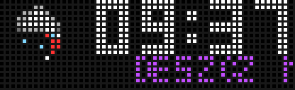 | 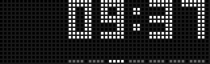 | 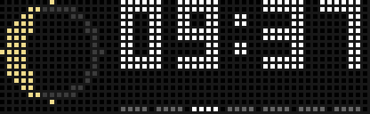 |

</p>

**NimbusPL** to rozbudowany, w pełni spolszczony fork popularnej aplikacji **Nimbus** przeznaczony dla zegarów z małą matrycą LED (52x16) sterowanych oprogramowaniem **AWTRIX Light** lub **Awtrix NG** (np. Ulanzi TC002).

Aplikacja płynnie łączy wyświetlanie zegara, kalendarza, prognozy pogody z Open-Meteo, stężenia pyłów **PM2.5**, odczytów temperatury i wilgotności w pomieszczeniu, ostrzeżeń **Meteoalarm** (IMGW) oraz serii efektów wizualnych (m.in. efekt wycieraczki chroniący matrycę przed powidokami).

---

## 🆕 Nowości w v2.11.0 PL

### ⛅ Biomet ciśnienia (zielony / żółty / czerwony)

- Karta **`10. Ciśnienie`** ocenia teraz **biomet** (samopoczucie) na podstawie wartości ciśnienia **i jego stabilności** (zmiana w ciągu 24 h):
  - 🟢 **Zielony** — ok. 1005–1020 hPa przy powolnych, minimalnych zmianach (sprzyja dobremu samopoczuciu),
  - 🟡 **Żółty** — spadek do 995–1004 hPa lub wzrost powyżej 1020 hPa (do 1035), albo zauważalne wahania 3–8 hPa/dobę (senność, znużenie),
  - 🔴 **Czerwony** — głęboki niż (poniżej 995 hPa), bardzo silny wyż (powyżej 1035 hPa) albo gwałtowne skoki (ponad 8 hPa/dobę): bóle głowy, migreny, rozdrażnienie.
- **Wartość i jednostka `hPa` są w kolorze biometu, tło czarne**, a między wartością a jednostką jest **odstęp 1 piksela**. Aplikacja zbiera historię ciśnienia (przy każdym odświeżeniu pogody) i liczy zmianę z ostatnich 24 godzin.

### 🌅 Nowa tarcza: `długość dnia`

- W opcji **`Tarcza zegara`** doszła czwarta tarcza — **`długość dnia`**: **duża godzina u góry (pełna wysokość)**, a **na dole, na całą szerokość, 1-pikselowy pasek 24 godzin** — od północy (lewy brzeg) do północy (prawy brzeg).
- Pasek jest **szary**, a **odcinek od wschodu do zachodu słońca świeci się na żółto** (dane `sunrise`/`sunset` z Open-Meteo w Twojej strefie czasowej).
- Pod godziną wyświetla się **długość dnia w godzinach na fioletowo** (np. `6:25 h` — mała litera, z odstępem = 6 godzin i 25 minut), więc odróżnia się od żółtego odcinka paska. **Pasek dni tygodnia jest na tej tarczy ukryty.** Komunikat meteoalarmu pojawia się w miejscu wartości.

### ☀️ Panel karuzeli `11. Długość dnia`

- Nowy panel **`11. Długość dnia`** pokazuje długość dnia w godzinach (**fioletowe cyfry**, np. `10:25 h` — mała litera, z odstępem; statycznie, bez przewijania) na pozostałych tarczach.
- Na tarczach `kartka`/`pierścień` wartość pojawia się **na dole, na całą szerokość** (jak na tarczy `duży`), **godzina zostaje pełnowymiarowa** — wartość schodzi niżej, więc nic nie nachodzi na siebie. Dodatkowo **pasek 24 h** (1 piksel, szary, z żółtym odcinkiem od wschodu do zachodu słońca), a **pasek dni tygodnia jest ukryty**.
- Ma **własny przełącznik** (grupa *Karuzela*) oraz **suwak `Czas długości dnia`** (1–60 s, domyślnie 5 s) — tyle trwa jego karta w rotacji.

---

## 🆕 Nowości w v2.10.0 PL

### 📡 Dane z Airly lub MQTT (opcjonalne nadpisanie pogody i PM2.5)

- Temperaturę i PM2.5 można teraz **nadpisać danymi z Airly** (`Klucz API Airly`) **albo po MQTT** (`MQTT: Temperatura zewnętrzna`, `MQTT: PM2.5`).
- **Priorytet: MQTT > Airly > Open-Meteo** — jeśli przychodzą dane MQTT, to one są wyświetlane; bez nich — Airly (gdy podano klucz); w przeciwnym razie Open-Meteo.
- **Suwak `Częstotliwość Airly`** (5–120 min, domyślnie **15 min**): co ile minut pobierać dane Airly. *15 minut jest optymalne dla darmowego konta Airly.*

### ⛅ Karta ciśnienia

- Nowy panel **`10. Ciśnienie`** — ciśnienie atmosferyczne z Open-Meteo (`pressure_msl`) z **jednostką `hPa` pod wartością**; ma własny przełącznik, tak jak pozostałe panele.

### 🏠 Etykiety `POKÓJ` i opis pogody

- Karty **temperatury i wilgotności z pokoju** mają teraz przewijaną etykietę **`POKÓJ`** — od razu widać, że to odczyty z pomieszczenia, a nie z zewnątrz. W opcjach uściślono też nazwy paneli: *Temperatura w pokoju* / *Wilgotność w pokoju*.
- Stan pogody `1` nazywa się teraz **`PRZEWAŻNIE BEZCHMURNIE`** zamiast *przeważnie słonecznie* — pasuje również w nocy.

---

## 🆕 Nowości w v2.9.0 PL

### 🌍 Wersje językowe

- Aplikacja podzielona na **5 wersji językowych** w katalogu `dist/`: `nimbus-tc002-PL.ax` (polski), `nimbus-tc002-en.ax` (angielski), `nimbus-tc002-de.ax` (niemiecki), `nimbus-tc002-es.ax` (hiszpański) i `nimbus-tc002-pt.ax` (portugalski).
- Każda wersja ma **menu, opisy pogody, dni tygodnia i miesiące we własnym języku** — selektor języka i pozostałe tłumaczenia zostały usunięte z kodu.
- **Wszystkie wersje mają Meteoalarm (IMGW)**. Wersja polska lokalizuje ostrzeżenia do powiatu (tabela TERYT, automatycznie ze współrzędnych), a wersje EN/DE/ES/PT działają **bez TERYT** — pokazują ostrzeżenie o najwyższym stopniu z całego kraju (mniejszy plik bez tabeli powiatów).

---

## 🆕 Nowości w v2.8.2 PL

### 🚨 Meteoalarm na dużej tarczy — nowy wygląd

- Na tarczy **duży** alert to teraz przewijany pasek: czarny napis **`METEOALARM`** na tle w kolorze stopnia zagrożenia, a za nim **komunikat w kolorze zagrożenia** — całość **przesuwa się razem** w lewo (mała przerwa i ponownie).

### 🔧 Poprawki

- **Panel wilgotności** nie dublował już znaku procentu (`45%` zamiast `45%%`) na tarczy kartka/pierścień i dużej.
- **Kod WMO 99 (`burza z silnym gradem`)** ma teraz osobny stan — wcześniej wyświetlał się jako zwykła *burza z gradem*. Dodany do wszystkich 6 języków, z własną ikonką i animacją.

---

## 🆕 Nowości w v2.8.1 PL

### 🌡️ Temperatury ujemne na tarczach `kartka` i `pierścień`

- Wartości z minusem (np. `-20`) zawsze używają **mniejszej czcionki** — minus i dwie cyfry mieszczą się bez przewijania, a kropka stopnia ma stały odstęp. Pozytywne dwucyfrowe wartości dalej używają dużej czcionki.

### 📊 Próg PM2.5 w karuzeli

- Nowa opcja **`Próg PM2.5`** (1–100 µg/m³, domyślnie **30**): kafelek PM2.5 pojawia się w rotacji **tylko wtedy, gdy stężenie przekroczy próg** — dokładnie tak jak porywy wiatru. Przy czystym powietrzu panel znika z karuzeli.

### ☁️ Nowe opisy pogody

- `chmury` → **`zachmurzenie`**, a dotychczasowe `zachmurzenie` → **`przelotne zachmurzenie`** (kody WMO 2 i 3).

### 🧊 Animacja ślizgającej się postaci

- Dla **marznącej mżawki i marznącego deszczu** (kody 56, 57, 66, 67) pod ikonką rozgrywa się w pętli scenka: **postać w czerwonej kurtce wchodzi na ekran, ślizga się, przewraca z nogami w górze, wstaje i wychodzi** — biała głowa i kończyny, czerwony tułów, na tle lodowoniebieskich kropel opadu.

---

## 🆕 Nowości w v2.8.0 PL

### 🌦️ Pogoda w pełnej rozdzielczości — 24 stany Open-Meteo

- Każdy kod WMO z Open-Meteo ma teraz **osobny stan** — intensywności nie są już łączone: `SILNA MŻAWKA`, `SILNA MŻAWKA MARZNĄCA`, `SILNY DESZCZ MARZNĄCY`, `ULEWNY PRZELOTNY DESZCZ`, `SILNY PRZELOTNY ŚNIEG`, `BURZA Z SILNYM GRADEM`, a także **`SZADŹ`** (48) i **`PRZEWAŻNIE BEZCHMURNIE`** (1).
- Każdy z 24 stanów ma własną ikonkę (lub animację opadu: kolor + tempo kropel/platków) we wszystkich 6 językach.
- Domyślne panele karuzeli to teraz **przełączniki z numerami 1–9** w zakładce *Karuzela*, a kolejność ustala się w polu **`Kolejność (numery)`** (numery po przecinku, np. `1,2,3,4,5,6,7,8,9`). Puste pole = kolejność domyślna: pogoda → porywy wiatru (gdy powyżej progu) → data → temperatura → PM2.5 → pokój → wilgotność → księżyc → meteoalarm.
- Naprawiony błąd, przez który własna kolejność z panelem `humidity`/`room` wywalała aplikację (`key_error`) — szerokość napisu `45%` była liczona czcionką bez znaku `%`.

---

## 🆕 Nowości w v2.7.2 PL

### 🌬️ Porywy wiatru na karuzeli

- Nowy panel karuzeli **`wind`**: gdy **porywy wiatru przekraczają ustawiony próg** (domyślnie 40 km/h, dane z Open-Meteo, `wind_gusts_10m`), do rotacji dołącza kafelek z **animowaną ikonką wiatru** (powiewająca czerwono-biała chorągiewka na maszcie) i **prędkością porywów** (`np. 100 km/h`) wyświetlaną **statycznie, na fioletowo**, na dole ekranu pod zegarem, od lewej krawędzi — w miejscu paska dni tygodnia, ukrywanego na czas kafelka.
- Gdy wiatr słabnie poniżej progu, panel sam znika z rotacji.
- Na czas kafelka **pasek dni tygodnia jest ukryty**, żeby nic nie nachodziło na prędkość (np. `100`).
- **Opcja włącz/wyłącz `Porywy wiatru`** (grupa *Karuzela*, domyślnie włączona).
- **Suwak `Próg porywów wiatru`** (10–100 km/h, domyślnie 40): kafelek dołącza do rotacji dopiero, gdy porywy przekroczą tę wartość.

<p align="center">
  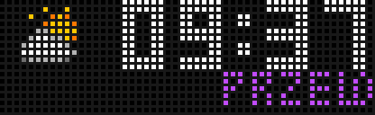
</p>

---

## 🆕 Nowości w v2.7.1 PL

### 🟣 Nowe kolory PM2.5 dla wysokich stężeń

- Panel PM2.5 ma teraz **6 kolorów**: przy **powyżej 90 µg/m³** tło robi się **fioletowe**, a powyżej **150 µg/m³ — granatowe** (czerwony obejmuje 56–90).
- Skala rozłożona tak, żeby dobrze różnicowała górny zakres — przydatne, gdy przekroczenia zdarzają się często. Progi dolne (12/35/55) odpowiadają US EPA AQI / indeksowi GIOŚ.

---

## 🆕 Nowości w v2.7.0 PL

### 🌙 Faza księżyca na karuzeli

- Nowy panel karuzeli **`moon`** — **ikonka księżyca na czarnym tle** z aktualną fazą, wyliczaną z daty (pełny cykl synodyczny 29,53 dnia).
- Terminator rysowany **w sposób ciągły** (nie tylko 8 faz) — sierp, kwadry, garby i pełnia wyglądają jak na prawdziwym niebie; ciemna część tarczy jest obrysowana na szaro, więc widać też **nów**.
- Na dużej tarczy panel pokazuje małą ikonkę fazy + nazwę fazy (`NÓW`, `SIERP`, `I KWADRA`, `GARB`, `PEŁNIA`, `III KWADRA`).
- **Opcja włącz/wyłącz `Faza księżyca`** (grupa *Karuzela*, domyślnie włączona) — panel sam dołącza się do rotacji, tak jak meteoalarm.

<p align="center">
  
</p>

---

## 🆕 Nowości w v2.6.0 PL

### 🌦️ Wszystkie stany pogody Open-Meteo (16 stanów + ikonki)

- Pełne pokrycie kodów WMO z Open-Meteo: **16 stanów pogody** z osobnymi ikonkami i animowanymi opadami — doszły m.in. **deszcz marznący, mżawka marznąca, krupa śnieżna, przelotny deszcz, przelotny śnieg** i **burza z gradem**.
- Każdy stan ma własny kolor i tempo kropel/platków opadu (m.in. lodowoniebieskie kropki dla opadów marznących), a burza z gradem dodatkowo błyskawicę.
- **Opis pogody przeniesiony do lewej strony** — krótki wyświetla się statycznie przy lewej krawędzi, długi (np. `DESZCZ MARZNĄCY`) przewija się w lewo, a **odstęp między powtórzeniami przewijanego opisu jest większy** (28 px przerwy).
- **Polskie znaki w opisach** (`ŚNIEG`, `ŚNIEŻYCA`, `MGŁA`, `MŻAWKA`, `DESZCZ MARZNĄCY`…), a nocą zamiast „Słonecznie” pokazuje się **`CZYSTE NIEBO`**.
- **Poprawione renderowanie ikonek** — piksele rysowane 1:1 (wcześniej część kolorów znikała albo rozciągała ikonę).

---

## 🆕 Nowości w v2.5.1 PL

### 🌤️ Panel pogody — wygodniejszy odczyt

- **Pasek dni tygodnia znika na czas panelu pogody** — ikonka i przewijany opis mają całą szerokość i nic ich nie zasłania; pasek wraca, gdy karuzela przechodzi do kolejnego panelu.
- **Nowy suwak `Czas panelu pogody`** (grupa *Karuzela*, domyślnie 10 s) — osobny czas wyświetlania ikonki pogody z przewijanym opisem, niezależny od `Czasu pozostałych paneli`. Wydłuż go, żeby spokojnie przeczytać cały opis.
- **Fioletowy opis pogody**: pojedynczy opis (np. `DESZCZ`) wyświetla się **statycznie, gdy mieści się** w szerokości ekranu, a gdy jest dłuższy (np. własne opisy) — **przewija się w lewo** (od v2.6.0 przy lewej krawędzi).

---

## 🆕 Nowości w v2.5.0 PL

### 🌤️ Nowy panel pogody (tarcze kartka / pierścień)

- Ikonka pogody została **zmniejszona do wysokości godziny** — zamiast dużego symbolu na całą wysokość pola panelu, nad kompozycją jest teraz mała ikonka stanu nieba.
- Pod ikonką, **na całą szerokość zegara (52 px)**, pokazuje się **opis pogody** (np. `DESZCZ`, `SNIEG`, `ZACHMURZENIE`) — krótki wyświetla się statycznie, dłuższy przewija się w lewo (od v2.5.1 w kolorze fioletowym).
- Kropki opadów (deszcz / śnieg) animują się nad ikonką; od v2.5.1 pasek dni tygodnia jest na czas panelu ukryty, a długość wyświetlania ustawisz suwakiem `Czas panelu pogody`.

### 🗑️ Usunięta tarcza `klapka`

- Stylizowany zegar klapkowy (*split-flap*) został **całkowicie usunięty** — był niefunkcjonalny na AWTRIX NG i mylił w menu. Do wyboru pozostały trzy w pełni działające tarcze: `kartka`, `pierścień`, `duży`.
- Zapisane ustawienia z `klapka` są automatycznie mapowane na `kartka` (bez błędów po aktualizacji).

---

## 🆕 Nowości w v2.4.0 PL

### 🚨 Meteoalarm (IMGW) — ostrzeżenia meteorologiczne

- **Automatyczny powiat**: aplikacja sama wyznacza najbliższy **powiat (kod TERYT)** na podstawie współrzędnych `Lat`/`Lon` — nie trzeba nic podawać. Można też wpisać kod TERYT ręcznie.
- Dane pobierane z oficjalnego API **IMGW** (`danepubliczne.imgw.pl`, polskie źródło Meteoalarm).
- Komunikat zawiera **rodzaj zagrożenia i czas jego obowiązywania**, np. `Silny wiatr 01:00-10:00` (przy zagrożeniu przechodzącym przez północ również z datami).
- Kolor komunikatu odpowiada stopniowi ostrzeżenia: 🟡 1, 🟠 2, 🔴 3.
- **Częstotliwość konfigurowalna osobno**: co ile minut pokazywać komunikat *w trakcie* zagrożenia i co ile *przed* jego rozpoczęciem (domyślnie 10 min / 60 min).
- **Czas wyświetlania komunikatu** ustawiany suwakiem (5–120 s).
- Alert **przejmuje pole karuzeli tylko na czas komunikatu** — po jego zakończeniu karuzela wraca sama.

Na tarczy **kartka** / **pierścień** alert wygląda tak (kafelek `METEOALARM` u góry, komunikat na całą szerokość pod zegarem, pasek dni schowany na czas komunikatu):

<p align="center">
  
</p>

Na tarczy **duży** alert pojawia się jako przewijany pasek: czarny napis `METEOALARM` na tle w kolorze zagrożenia, a obok niego **komunikat w kolorze zagrożenia** — przesuwają się razem:

<p align="center">
  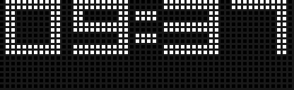
</p>

### ⌚ Pozostałe zmiany

- **Nazwa aplikacji**: `Nimbus` → **`NimbusPL`** (łatwiej odróżnić od oryginalnego Nimbusa w panelu AWTRIX NG).
- **Duża tarcza**: 5-literowy dzień tygodnia (`NIEDZ` / `PONIE` / `WTORE` / `SRODA` / `CZWAR` / `PIATE` / `SOBOT`).
- **Tarcza kartka**: godzina przy górnej krawędzi — dzięki temu pod zegarem jest miejsce na pełnowymiarowy komunikat meteoalarmu.

---

## 🎨 Tarcze Zegara (Style Wyglądu)

Aplikacja oferuje 3 unikalne warianty tarczy zegara do wyboru w panelu konfiguracyjnym:

| Podgląd | Nazwa w opcjach | Opis |
| :---: | :---: | :--- |
| 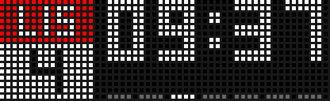 | `kartka` | **Klasyczna kartka z kalendarza** z animowanym "zrywaniem" kartki, godziną przy górnej krawędzi i miejscem pod nią na komunikaty. |
| 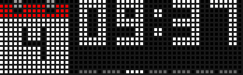 | `pierścień` | **Nowoczesna tarcza cyfrowa** otoczona płynnie obracającym się pierścieniem sekundnika. |
| 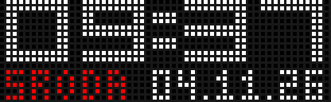 | `duży` | **Duży zegar na pełną szerokość** matrycy z 5-literowym dniem tygodnia, przewijanym u dołu tekstem daty, opisem pogody i alertami meteoalarmu. |
| 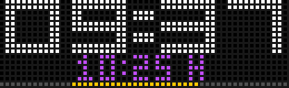 | `długośćdnia` | **Długość dnia**: duża godzina u góry, fioletowa długość dnia pod nią (np. `6:25 h`) i szary 1-pikselowy pasek 24 h z żółtym odcinkiem wschód–zachód słońca. Bez paska dni tygodnia. |

---

## 🚨 Meteoalarm — jak to działa?

1. W opcjach włącz **`Włącz Meteoalarm`** (grupa *Pogoda i Powietrze*).
2. Aplikacja bierze współrzędne `Lat`/`Lon` (te same, których używa Open-Meteo) i dopasowuje do nich **najbliższy powiat** z wbudowanej tabeli 380 powiatów (kod TERYT + środek). Jeśli chcesz wymusić konkretny powiat, wpisz jego 4-cyfrowy kod w polu **`TERYT powiatu`** (np. `1465` dla Warszawy). Kody powiatów znajdziesz w wyszukiwarce GUS: [eteryt.stat.gov.pl](https://eteryt.stat.gov.pl/).
3. Co `Odświeżanie Meteoalarmu` (domyślnie 10 min) aplikacja odpytuje API IMGW o ostrzeżenia dla tego powiatu.
4. Gdy jest aktywne ostrzeżenie, co `Częstotliwość w trakcie zagrożenia` (domyślnie 10 min) wyświetla komunikat; gdy ostrzeżenie jeszcze nie obowiązuje — co `Częstotliwość przed zagrożeniem` (domyślnie 60 min).
5. Komunikat (długość ustawia `Czas komunikatu`) **przejmuje pole karuzeli**: na tarczy kartka/pierścień pojawia się kafelek `METEOALARM` + tekst na całej szerokości pod zegarem (pasek dni tygodnia jest wtedy schowany), a na tarczy duży — przewijany pasek `METEOALARM` z komunikatem w miejscu linii daty.
6. Po zakończeniu komunikatu karuzela wraca do normalnego działania.

> ℹ️ **Dlaczego podpowiedzi w panelu są krótkie?** AWTRIX NG ucina teksty pomocy (`help`) do 96 znaków i nie renderuje w nich linków — to limit firmware, którego aplikacja nie może obejść. Pełne opisy, linki i instrukcje znajdziesz w tym README (oraz na stronie aplikacji w AWTRIX Hub).

> ℹ️ **Województwo czy powiat?** API IMGW zwraca ostrzeżenia per powiat, dlatego alert dotyczy **powiatu**, a nie całego województwa. Dzięki temu komunikaty są precyzyjniejsze (np. "Silny wiatr" tylko tam, gdzie faktycznie obowiązuje).

---

## 🌟 Główne Funkcje

### 1. 🍃 Jakość Powietrza PM2.5 (Open-Meteo Air Quality)
- **Bez zewnętrznych czujników** – dane o stężeniu pyłów PM2.5 pobierane są automatycznie z darmowego API Open-Meteo na podstawie podanych współrzędnych geograficznych (`Lat`, `Lon`).
- **Dedykowany układ graficzny:** po lewej stronie wyświetlany jest biały napis **PM**, a po prawej boks z kolorowym tłem i pogrubioną, czarną wartością stężenia.
- **Dynamiczne kolory wg progów US EPA AQI / polskiego indeksu GIOŚ:**

| Stężenie PM2.5 | Kolor tła | Jakość powietrza |
| :--- | :---: | :--- |
| $\le 12\,\mu\text{g/m}^3$ | 🟢 **Zielony** | **Dobra** – czyste powietrze |
| $13 - 35\,\mu\text{g/m}^3$ | 🟡 **Żółty** | **Umiarkowana** – dopuszczalna jakość |
| $36 - 55\,\mu\text{g/m}^3$ | 🟠 **Pomarańczowy** | **Niezdrowa** dla grup wrażliwych |
| $56 - 90\,\mu\text{g/m}^3$ | 🔴 **Czerwony** | **Niezdrowa** – wysokie zanieczyszczenie |
| $91 - 150\,\mu\text{g/m}^3$ | 🟣 **Fioletowy** | **Bardzo zła** – poważne przekroczenia |
| $> 150\,\mu\text{g/m}^3$ | 🔵 **Granatowy** | **Ekstremalna** – zagrożenie dla zdrowia |

> 📡 **Skąd dane?** Domyślnie PM2.5 pochodzi z Open-Meteo Air Quality. Po podaniu `Klucza API Airly` kafelek pokaże odczyt z Airly, a po podaniu tematu `MQTT: PM2.5` — wartość z MQTT. Priorytet: **MQTT > Airly > Open-Meteo**.

### 2. 🌤️ Rozbudowana Pogoda (25 Stanów WMO)
- Pełna integracja z **Open-Meteo Forecast API** — obsłużone są **wszystkie kody WMO** z rozróżnieniem intensywności.
- Na tarczach `kartka` / `pierścień` panel pogody to **mała ikonka na wysokości godziny** z animowanymi kropkami opadów, a pod nią **fioletowy opis stanu** (np. `DESZCZ`) — statyczny przy lewej krawędzi, gdy się mieści, przewijany w lewo, gdy jest dłuższy.
- **25 stanów pogodowych** z ikonkami pikselowymi i animacjami opadów:

| Stan | Kody WMO |
| :--- | :---: |
| ☀️ Słonecznie (dzień) / 🌙 Czyste niebo (noc) | `0` |
| 🌤️ Przeważnie bezchmurnie | `1` |
| 🌤️ Przelotne zachmurzenie | `2` |
| ☁️ Zachmurzenie | `3` |
| 🌫️ Mgła | `45` |
| 🌫️ Szadź | `48` |
| 🌦️ Mżawka | `51`, `53` |
| 🌦️ Silna mżawka | `55` |
| ❄️ Mżawka marznąca | `56` |
| ❄️ Silna mżawka marznąca | `57` |
| 🌧️ Deszcz | `61`, `63` |
| ⛈️ Ulewa | `65` |
| 🧊 Deszcz marznący | `66` |
| 🧊 Silny deszcz marznący | `67` |
| 🌨️ Śnieg | `71`, `73` |
| ❄️ Śnieżyca | `75` |
| 🌨️ Krupa śnieżna | `77` |
| 🌦️ Przelotny deszcz | `80`, `81` |
| ⛈️ Ulewny przelotny deszcz | `82` |
| 🌨️ Przelotny śnieg | `85` |
| ❄️ Silny przelotny śnieg | `86` |
| ⛈️ Burza | `95` |
| 🌩️ Burza z gradem | `96` |
| 🌩️ Burza z silnym gradem | `99` |

### 🎬 Animacje wszystkich stanów (GIF)

| | | |
| :---: | :---: | :---: |
| 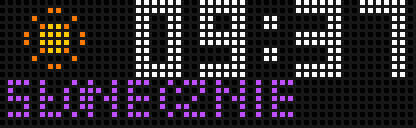<br>Słonecznie | 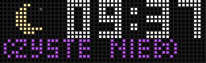<br>Czyste niebo (noc) | 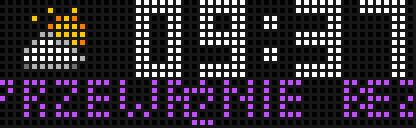<br>Przeważnie bezchmurnie |
| 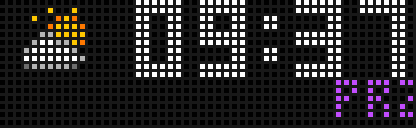<br>Przelotne zachmurzenie | 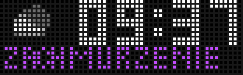<br>Zachmurzenie | 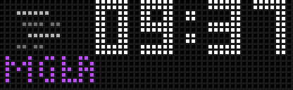<br>Mgła |
| 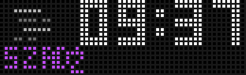<br>Szadź | 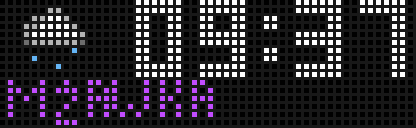<br>Mżawka | 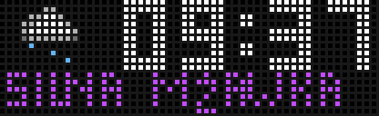<br>Silna mżawka |
| 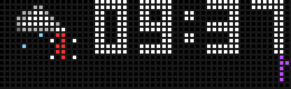<br>Mżawka marznąca | 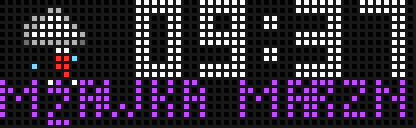<br>Silna mżawka marznąca | 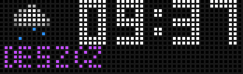<br>Deszcz |
| 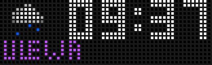<br>Ulewa | 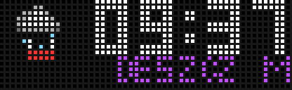<br>Deszcz marznący | 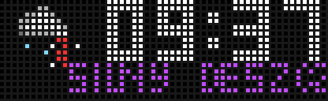<br>Silny deszcz marznący |
| 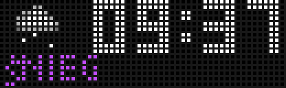<br>Śnieg | 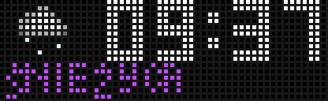<br>Śnieżyca | 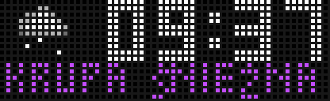<br>Krupa śnieżna |
| 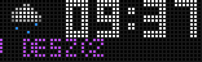<br>Przelotny deszcz | 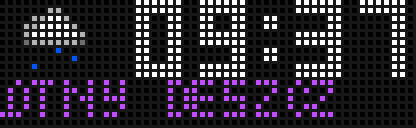<br>Ulewny przelotny deszcz | 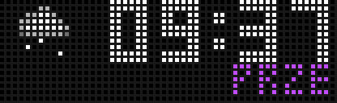<br>Przelotny śnieg |
| 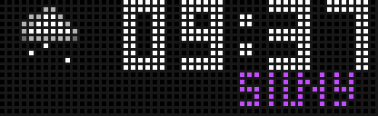<br>Silny przelotny śnieg | 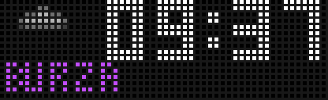<br>Burza | 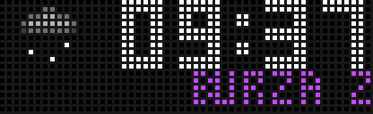<br>Burza z gradem |
| 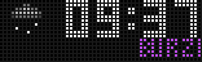<br>Burza z silnym gradem | | |

### 3. ⛅ Ciśnienie Atmosferyczne i Biomet
- Panel karuzeli **`Ciśnienie`** — wartość `pressure_msl` z Open-Meteo z **jednostką `hPa`** (odstęp 1 piksela; na dużej tarczy obok wartości).
- **Biomet**: wartość i jednostka mają kolor zależny od wpływu ciśnienia na samopoczucie (wartość + zmiana z 24 h):

| Warunek | Kolor | Biomet |
| :--- | :---: | :--- |
| 1005–1020 hPa, stabilne | 🟢 **Zielony** | **Korzystny** – dobre samopoczucie, koncentracja |
| 995–1004 hPa, 1021–1035 hPa lub wahania 3–8 hPa/dobę | 🟡 **Żółty** | **Lekko niekorzystny** – senność, znużenie |
| < 995 hPa, > 1035 hPa lub skoki > 8 hPa/dobę | 🔴 **Czerwony** | **Bardzo niekorzystny** – bóle głowy, migreny |

- Panel ma własny przełącznik **`10. Ciśnienie`** w grupie *Karuzela* (domyślnie włączony).

### 4. 📡 Dane z Airly / MQTT (Opcjonalne Nadpisanie)
- **Temperatura i PM2.5** mogą pochodzić z trzech źródeł z priorytetem **MQTT > Airly > Open-Meteo**:
  1. **MQTT** — tematy `MQTT: Temperatura zewnętrzna` i `MQTT: PM2.5` (broker z ustawień AWTRIX); jakiekolwiek dane z MQTT mają pierwszeństwo.
  2. **Airly** — po podaniu `Klucza API Airly` (api.airly.eu); częstotliwość ustawia `Częstotliwość Airly` (domyślnie 15 min — optymalne dla darmowego konta).
  3. **Open-Meteo** — domyślne źródło, gdy powyższe są puste.

### 5. 🌅 Długość Dnia (Tarcza i Panel)
- **Tarcza `długość dnia`**: duża godzina u góry + fioletowa długość dnia pod nią (np. `6:25 h`) oraz szary 1-pikselowy pasek 24 h na dole (od północy do północy) z **żółtym odcinkiem od wschodu do zachodu słońca** (dane `sunrise`/`sunset` z Open-Meteo).
- Na tej tarczy **pasek dni tygodnia jest ukryty**, a komunikat meteoalarmu pojawia się w miejscu wartości.
- **Panel `11. Długość dnia`** (przełącznik + suwak `Czas długości dnia`) pokazuje to samo na pozostałych tarczach.

### 6. 🧹 Efekt "Wycieraczki" (Ochrona Matrycy LED)
- Co dokładnie 5 minut przez ekran przesuwa się płynny, czarny pas czyszczący (800 ms).
- Efekt odświeża diody LED, zapobiega utrwalaniu powidoków (*burn-in*) i dodaje unikalny retro akcent.

### 7. 🇵🇱 Pełne Spolszczenie i Poprawki Parsera
- 100% przetłumaczonych opcji, kategorii, opisów i podpowiedzi w panelu WWW AWTRIX.
- Poprawiony parser Berry (`re.search`) – wyeliminowano błędy `syntax_error` przy pobieraniu danych JSON.

---

## ⚙️ Instrukcja Instalacji

1. Pobierz plik z katalogu [`dist/`](./dist/) — wybierz wersję językową: **`nimbus-tc002-PL.ax`** (polski, Meteoalarm z lokalizacją do powiatu) lub `nimbus-tc002-en.ax` / `-de.ax` / `-es.ax` / `-pt.ax` (menu w danym języku, Meteoalarm bez TERYT — najwyższy alert z całej Polski).
2. Otwórz panel zarządzania zegarem AWTRIX w przeglądarce (wpisz adres IP zegara w sieci lokalnej).
3. Przejdź do zakładki **Files** / **Apps** (lub połącz się przez FTP/Samba).
4. Wgraj plik do katalogu `/apps/`.
5. Zrestartuj zegar lub przeładuj aplikacje.
6. W ustawieniach aplikacji (pozycja **NimbusPL** — lub NimbusEN/DE/ES/PT) wprowadź swoje współrzędne geograficzne (`Lat`, `Lon`) — posłużą do pogody, PM2.5 i (w wersji PL) meteoalarmu. Aby korzystać z ostrzeżeń, włącz **`Włącz Meteoalarm`**.

---

## 🎛️ Konfiguracja Karuzeli Paneli

Każdy panel ma **swój przełącznik i numer** (wszystkie przełączniki w grupie **Karuzela**):

| Nr | Panel | Opis widoku |
| :---: | :--- | :--- |
| `1` | Pogoda | Mała ikonka pogody + fioletowy opis stanu (statyczny lub przewijany w lewo) |
| `2` | Porywy wiatru | Pojawia się, gdy porywy przekroczą próg — animowana ikonka + fioletowa prędkość (`100 km/h`) pod zegarem |
| `3` | Data | Kartka kalendarza / Data |
| `4` | Temperatura | Temperatura na zewnątrz (Open-Meteo) |
| `5` | PM2.5 | Stężenie pyłu PM2.5 z dynamicznym tłem |
| `6` | Pokój | Temperatura w pokoju (czujnik/MQTT); pomijany bez danych |
| `7` | Wilgotność | Wilgotność w pokoju (czujnik/MQTT); pomijany bez danych |
| `8` | Faza księżyca | Aktualna faza księżyca — ikonka na czarnym tle |
| `9` | Meteoalarm | Ostrzeżenia Meteoalarm/IMGW (kafelek `METEOALARM` lub przewijany pasek `METEOALARM` z komunikatem) |
| `10` | Ciśnienie | Ciśnienie z Open-Meteo z **biometem** — wartość i `hPa` w kolorze biometu (zielony/żółty/czerwony) |
| `11` | Długość dnia | Długość dnia w godzinach na dole ekranu (fioletowe cyfry, np. `10:25 h`, statycznie) + 1-pikselowy pasek 24 h (dni tygodnia ukryte) — czas karty ustawisz suwakiem |

**Kolejność ustalasz w polu `Kolejność (numery)`** — wpisujesz numery po przecinku, np.:

```text
1,2,3,4,5,6,7,8,9,10,11
```

- Puste pole = **kolejność domyślna** (pogoda → wiatr → data → temperatura → PM2.5 → pokój → wilgotność → księżyc → meteoalarm → ciśnienie → długość dnia).
- Niepełna lista (np. `1,3`) ustawia te panele na początku, a resztę dokleja w kolejności numerów.
- Panel `2` (porywy wiatru) pojawia się tylko, gdy wiatr przekroczy próg — jego numer w polu kolejności oznacza, gdzie ma się wtedy pojawić.
- Powtórzone i błędne numery są ignorowane.

> 💡 Komunikat meteoalarmu jest pokazywany **poza rotacją** — w momencie, gdy obowiązuje ostrzeżenie (częstotliwość ustawisz w opcjach).

---

## 📋 Tabela Wszystkich Opcji w Panelu WWW

| Grupa | Opcja | Domyślnie | Opis |
| :--- | :--- | :---: | :--- |
| **Wyświetlacz** | `Efekt wycieraczki` | `tak` | Pas czyszczący matrycę przechodzący co 5 minut |
| **Czas** | `Zegar 24-godzinny` | `tak` | Format 24h lub 12h (AM/PM) |
| | `Zero wiodące` | `tak` | Wyświetlanie godziny np. jako `08:00` zamiast `8:00` |
| | `Dwukropek` | `pulsowanie` | Tryby: `stały`, `mrugający`, `pulsowanie` |
| | `Kolor godziny` | `#FFFFFF` | Główny kolor cyfr zegara |
| | `Tarcza zegara` | `kartka` | Wybór stylu: `kartka`, `pierścień`, `duży`, `długośćdnia` |
| **Kalendarz** | `Nagłówek`, `Tekst`, `Tło` | — | Kolorystyka kartki kalendarza |
| | `Animacja kalendarza` | `tak` | Zrywanie kartki przy przełączaniu i o północy |
| | `Format daty` | `dd.mm.yy` | Format daty na dużej tarczy (`dd.mm.yy`, `mm/dd/yy`, `yy-mm-dd`) |
| **Pasek tygodnia** | `Pasek tygodnia` | `tak` | Pasek z 7 kropkami na dole ekranu |
| | `Tydzień od poniedziałku` | `tak` | Rozpoczynanie tygodnia od Poniedziałku zamiast Niedzieli |
| **Karuzela** | `1. Pogoda` | `tak` | Panel numer 1 w polu kolejności |
| | `2. Porywy wiatru` | `tak` | Panel numer 2; pojawia się powyżej progu porywów |
| | `3. Data` | `tak` | Panel numer 3 |
| | `4. Temperatura` | `tak` | Panel numer 4 |
| | `5. PM2.5` | `tak` | Panel numer 5 |
| | `6. Pokój` | `tak` | Panel numer 6 (pomijany bez danych) |
| | `7. Wilgotność` | `tak` | Panel numer 7 (pomijany bez danych) |
| | `8. Faza księżyca` | `tak` | Panel numer 8 |
| | `9. Meteoalarm` | `nie` | Panel numer 9 (ostrzeżenia IMGW) |
| | `10. Ciśnienie` | `tak` | Panel numer 10 (hPa z biometem) |
| | `11. Długość dnia` | `tak` | Panel numer 11 (długość dnia w godzinach) |
| | `Czas długości dnia` | `5 s` | Jak długo wyświetlać panel długości dnia (1–60 s) |
| | `Kolejność (numery)` | *(puste)* | Numery paneli po przecinku, np. `1,2,3,4,5,6,7,8,9,10,11`; puste = domyślna |
| | `Czas daty`, `Czas paneli` | `10s / 3s` | Czas wyświetlania daty oraz pozostałych paneli |
| | `Czas panelu pogody` | `10 s` | Osobny czas panelu pogody (ikonka + przewijany opis) |
| | `Próg porywów wiatru` | `40 km/h` | Porywy muszą przekroczyć ten próg (10–100 km/h), by kafelek pojawił się w rotacji |
| | `Próg PM2.5` | `30` | Stężenie musi osiągnąć ten próg (1–100 µg/m³), by kafelek PM2.5 pojawił się w rotacji |
| | `Przejście` | `przetarcie` | Animacja przejścia (`przetarcie`, `zanikanie`, `przejście`, `dół`, `góra`, `lewo`, `prawo`, `brak`) |
| **Pogoda i Powietrze** | `Lat`, `Lon` | — | Współrzędne dla Open-Meteo, Airly **i Meteoalarmu** |
| | `Odświeżanie` | `15 min` | Częstotliwość pobierania danych pogodowych z API |
| | `Klucz API Airly` | *(puste)* | Opcjonalny klucz API Airly; podany: temperatura i PM2.5 z Airly zamiast Open-Meteo |
| | `Częstotliwość Airly` | `15 min` | Co ile minut pobierać dane Airly (5–120); 15 minut jest optymalne dla darmowego konta |
| | `MQTT: Temperatura zewnętrzna` | *(puste)* | Nadpisuje temperaturę z Open-Meteo/Airly; puste = automatycznie |
| | `MQTT: PM2.5` | *(puste)* | Nadpisuje PM2.5 z Open-Meteo/Airly; puste = automatycznie |
| | `Opisy pogody` | `Polski` | Język opisów dla dużej tarczy |
| | `Własne opisy` | *(puste)* | Duża tarcza. Do 16 opisów po przecinku, w kolejności stanów z tabeli powyżej (noc ma stały opis) |
| | `Włącz Meteoalarm` | `nie` | Ostrzeżenia IMGW dla powiatu wyznaczonego ze współrzędnych |
| | `TERYT powiatu` | *(puste)* | Ręczny 4-cyfrowy kod TERYT powiatu (np. `1465` = Warszawa); puste = automatycznie ze współrzędnych. Lista kodów: eteryt.stat.gov.pl |
| | `Odświeżanie Meteoalarmu` | `10 min` | Co ile minut pobierać alert z API IMGW |
| | `Czas komunikatu` | `15 s` | Jak długo wyświetlać komunikat ostrzeżenia (5–120 s) |
| | `Częstotliwość w trakcie zagrożenia` | `10 min` | Co ile minut pokazywać komunikat, gdy ostrzeżenie obowiązuje |
| | `Częstotliwość przed zagrożeniem` | `60 min` | Co ile minut pokazywać komunikat, zanim ostrzeżenie się rozpocznie |
| **Pokój** | `MQTT Topics` | — | Ścieżki MQTT dla temperatury i wilgotności z Home Assistant |
| **Tryb nocny** | `Automatyczny tryb nocny` | `nie` | Automatyczne przyciemnienie i wstrzymanie rotacji w wybranych godzinach |

---

## 👤 Autorzy & Podziękowania

- **AkdM** – Autor oryginalnej aplikacji [Nimbus (v2.0)](https://bluebeards.org/awtrix/) opublikowanej w AWTRIX Hub.
- **olo81** – Modyfikacja, polska lokalizacja, wdrożenie jakości powietrza PM2.5, efekt wycieraczki, **Meteoalarm (IMGW/Teryt)**, zmiana nazwy na **NimbusPL** oraz poprawki stabilności.
- Dane powiatów TERYT na podstawie otwartych repozytoriów TERC/geometrii Polski.

---

## 📜 Licencja

Projekt udostępniany na zasadach open-source, zgodnie z pierwotną licencją projektu Nimbus dla systemu AWTRIX Light.
