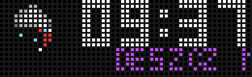
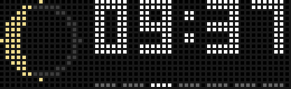

# NimbusPL 🕒🌦️🚨

**Rozbudowany, w pełni spolszczony zegar dla AWTRIX NG / AWTRIX Light na matrycy 52×16 (np. Ulanzi TC002).**

Fork popularnej aplikacji **Nimbus** — godzina, kalendarz z animowaną kartką, **25 stanów pogody Open-Meteo** z animacjami, **PM2.5** z progiem alarmowym, porywy wiatru, faza księżyca, odczyty z pokoju (MQTT / czujnik) oraz **ostrzeżenia Meteoalarm (IMGW)** z automatycznym wykrywaniem powiatu.

---

## ✨ Najważniejsze funkcje

- 🎨 **Trzy tarcze zegara**: `kartka` (kalendarz z efektem zrywania kartki), `pierścień` (obracający się sekundnik), `duży` (pełna szerokość).
- 🌦️ **Pogoda w pełnej rozdzielczości** — wszystkie 24 kody WMO Open-Meteo z własnymi ikonkami, animowanymi opadami i polskimi opisami (fioletowy opis pod ikonką, przewijany gdy długi). Dla marznących opadów — animacja **postaci w czerwonej kurtce, która wchodzi, ślizga się, przewraca, wstaje i wychodzi z ekranu** 🧊.
- 🌬️ **Porywy wiatru** — czerwono-biała powiewająca flaga + prędkość (pojawia się dopiero powyżej ustawionego progu).
- 🍃 **PM2.5** — kafelek w kolorze poziomu (zielony → żółty → pomarańczowy → czerwony → fioletowy → granatowy), pokazywany dopiero od ustawionego progu (domyślnie 30 µg/m³).
- 🌙 **Faza księżyca** — ikona z terminatorem na czarnym tle.
- 🚨 **Meteoalarm (IMGW)** — pełnoprawny system ostrzeżeń pogodowych dla **powiatu wyznaczonego automatycznie ze współrzędnych** (lub ręcznie po TERYT). Komunikat z czasem zagrożenia przejmuje karuzelę co kilka minut, z osobną częstotliwością przed i w trakcie zagrożenia.
- 🎛️ **Karuzela 9 paneli z numerami** — każdy panel ma własny przełącznik, a kolejność ustalasz wpisując numery po przecinku w polu `Kolejność (numery)`.
- 🌙 **Tryb nocny** — czerwony zegar, jasność, automatyczne godziny, MQTT.
- 🧹 **Efekt wycieraczki** — pas czyszczący matrycę co 5 minut.

## 📸 Podgląd

| Karuzela paneli | Meteoalarm (IMGW) | Faza księżyca |
| :---: | :---: | :---: |
|  |  |  |

Wszystkie stany pogody: [animacje](https://github.com/olo81/awtrix-ng-nimbus-clock-weather-PL/tree/main/docs) (weather-*.gif w repozytorium).

## 🚀 Instalacja

1. Pobierz [`dist/nimbus-tc002.ax`](https://raw.githubusercontent.com/olo81/awtrix-ng-nimbus-clock-weather-PL/main/dist/nimbus-tc002.ax).
2. Wgraj plik do katalogu `/apps/` zegara (panel WWW → Files, lub FTP/Samba) i zrestartuj aplikacje.
3. W ustawieniach aplikacji **NimbusPL** podaj szerokość i długość geograficzną (`Lat`, `Lon`) — służą pogodzie, PM2.5 i automatycznemu powiatowi meteoalarmu.
4. Aby korzystać z ostrzeżeń, włącz **`9. Meteoalarm`** w zakładce *Karuzela*.

## ⚙️ Najważniejsze ustawienia

- **Karuzela**: przełączniki paneli `1. Pogoda` … `9. Meteoalarm`, pole `Kolejność (numery)` (np. `1,2,3,4,5,6,7,8,9`), czasy paneli, `Próg porywów wiatru`, `Próg PM2.5`.
- **Pogoda i Powietrze**: współrzędne, `TERYT powiatu` (puste = automatycznie), `Włącz Meteoalarm`, częstotliwości komunikatu przed i w trakcie zagrożenia.
- **Pokój**: tematy MQTT temperatury i wilgotności (np. Home Assistant).
- **Tryb nocny**: automatyczne godziny, jasność, wstrzymanie rotacji.

## 👤 Autorzy

- **AkdM** — oryginalny Nimbus dla AWTRIX.
- **olo81** — polska lokalizacja, meteoalarm IMGW, PM2.5, porywy wiatru, księżyc i pozostałe rozszerzenia.

Projekt open-source (MIT), repozytorium: [github.com/olo81/awtrix-ng-nimbus-clock-weather-PL](https://github.com/olo81/awtrix-ng-nimbus-clock-weather-PL)
